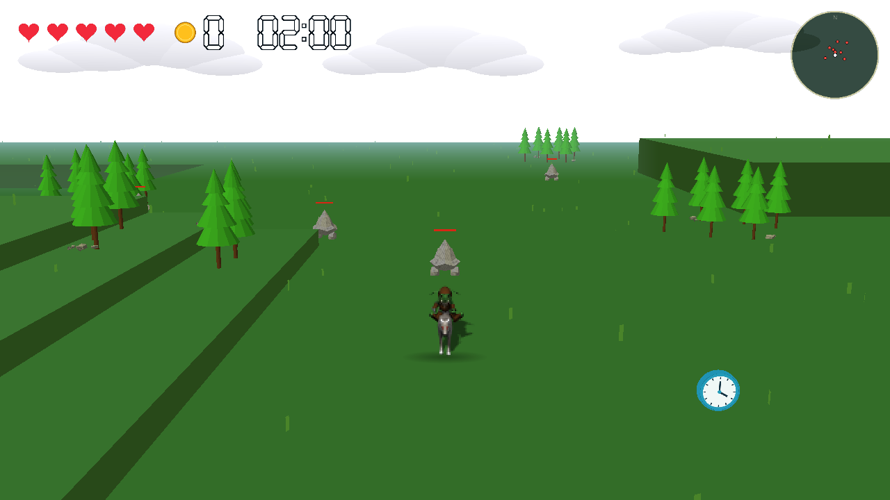
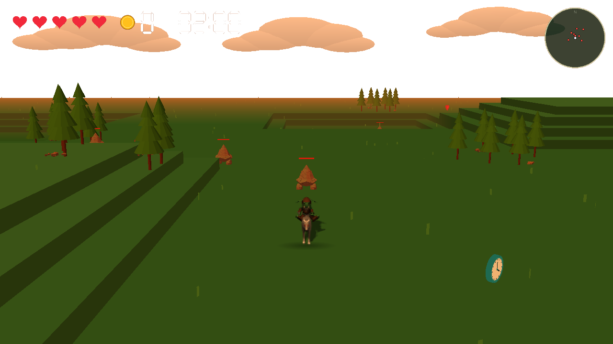
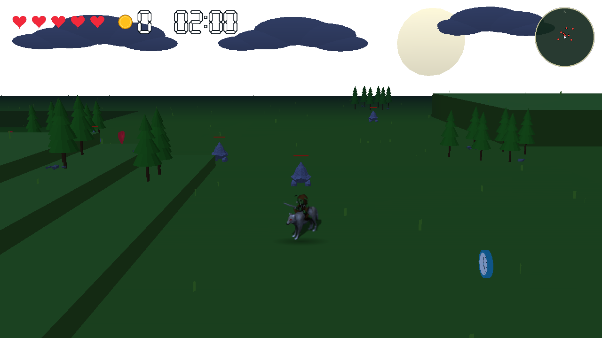
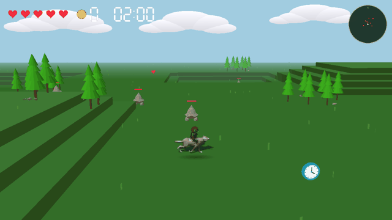
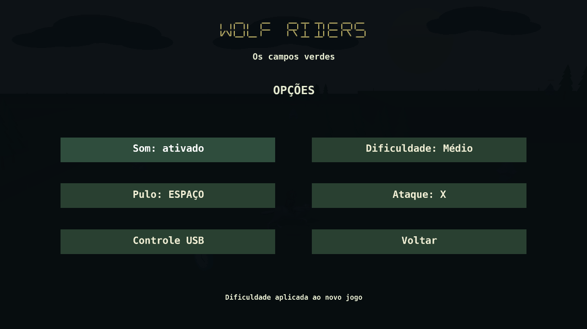
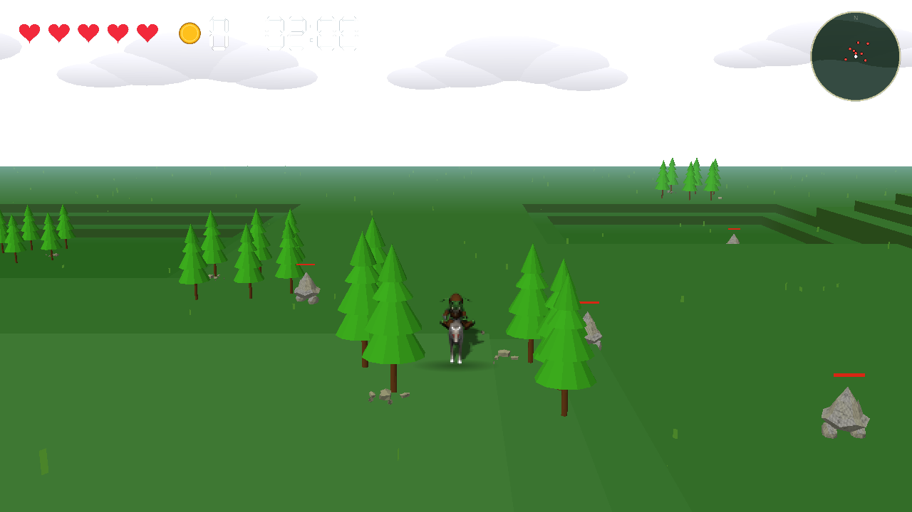

# Wolf Riders

Protótipo de exploração e combate em Python/Panda3D: campo verde tridimensional com bosques e inimigos com câmera de acompanhamento e o cavaleiro de `assets/img/wolf_riders.png`. O personagem usa sprites direcionais em um plano voltado para a câmera; o asset fornecido é uma imagem, não um modelo 3D com esqueleto.

## Executar

Com Python 3.12 (versão validada):

```bash
python3 -m venv .venv
.venv/bin/python -m pip install -r requirements.txt
.venv/bin/python main.py
```

Precisa de ambiente gráfico com suporte a OpenGL. A música fornecida em `assets/sound/theme.wav` toca em loop no menu e no campo enquanto o som estiver ativado.

## Controles e menu

- **Novo jogo:** inicia a fase da manhã no centro, com cinco vidas, a quantidade de monstros da dificuldade escolhida, dois corações aleatórios, três relógios e zero moedas; substitui a partida salva. Cada fase começa com 2 minutos.
- **Continuar:** retoma o último salvamento; fica desabilitado quando não existe um save válido.
- **Opções:** configura som, teclas de ação e dificuldade; mantém as preferências entre sessões.
- **WASD ou setas:** andar nas oito direções, com animação correspondente.
- **Shift + movimento:** correr, com velocidade e cadência maiores.
- **Espaço:** pular; não há salto duplo.
- **X:** atacar na direção atual; dois golpes derrotam um inimigo.
- **Esc:** volta ao menu e salva; nas opções, volta ao menu.
- **Sair/fechar janela:** encerra e salva quando estiver jogando.

Fase atual, dificuldade da partida, posição, vida, moedas recolhidas, tempo restante, estado dos inimigos, moedas no chão, corações e relógios coletados são salvos a cada cinco segundos e ao voltar ao menu. Dados ficam em `.local/save.json` e `.local/settings.json`. O campo tem limites para manter o personagem no terreno. Perder o foco limpa as teclas pressionadas, mas mantém o jogo em execução, inclusive ao tirar Print Screen. Esc continua abrindo o menu e pausando.

## Testes

```bash
.venv/bin/python -m pip install -r requirements-dev.txt
.venv/bin/python -m pytest -q
RUN_GRAPHICS_TESTS=1 .venv/bin/python -m pytest -q
```

O teste gráfico cria um contexto offscreen e usa áudio nulo: valida integração, mas não comprova que os alto-falantes estão reproduzindo música.

Validação manual: iniciar e conferir o menu; iniciar um jogo; andar em todas as direções; correr e parar; conferir câmera, sprites e pés no terreno; voltar com Esc; continuar; fechar/reabrir e continuar; desativar/ativar som nas opções e ouvir a mudança. Também confira salto/aterrissagem, ataque frontal, inimigo fora do alcance, perseguição, dano por contato, bloqueio dos bosques e persistência dos inimigos derrotados. A verificação humana de controles e reprodução audível permanece necessária.

## Asset e renderização

A folha tem 42 colunas e oito linhas de células de 128 px. Linhas são oeste, noroeste, norte, nordeste, leste, sudeste, sul e sudoeste. A coluna 0 representa repouso; colunas 4–11 formam o ciclo de deslocamento identificado visualmente. Caminhada e corrida compartilham esse ciclo, com cadências diferentes. O ataque usa as colunas 12–17; o salto eleva o sprite e mantém a animação de movimento. Não há uma sequência específica de salto no asset identificado.

Coordenadas: X para leste, Y para norte, Z para cima. Movimento usa tempo decorrido, normaliza diagonais e limita intervalos longos para evitar saltos após interrupções. Os assets foram fornecidos pelo usuário e preservados.

Referências técnicas: [renderização de imagens em Panda3D](https://docs.panda3d.org/1.11/cpp/programming/gui/rendering-images) e [carregamento de música](https://docs.panda3d.org/1.10/python/reference/direct.showbase.Loader).

## Cenário e combate

Dez conjuntos de árvores usam `assets/img/low.obj`. O OBJ reúne troncos e copas no mesmo grupo e referencia `low.mtl`, que não foi fornecido; cores são aplicadas pela altura das faces. O plano de chão incluído no OBJ é removido. Colisão acompanha cada tronco e pequena pedra do OBJ, considerando a escala e a rotação do bosque. As copas e os espaços livres entre árvores permitem passagem e coleta de moedas. O raio do personagem impede que seu corpo atravesse os troncos. Saves dentro de um tronco ou pedra são deslocados para uma posição livre próxima.

As piscinas foram removidas. Seus antigos pontos acompanham a altura do terreno local e permitem movimentação em velocidade normal.

Os inimigos usam a geometria de `assets/img/stilagmate.blend`, com textura procedural de pedra, altura de 1.45 unidade, iluminação e barras de vida. Fogem do jogador quando ele está a menos de 19 unidades, respeitando os limites do campo e desviando por eixo nas áreas bloqueadas. Não há navegação completa em torno dos bosques. Têm dois pontos de vida; golpes frontais alcançam 3.8 unidades, com intervalo de 0.6 segundo. O dano ocorre no início do golpe. Ataques muito altos não acertam o chão.

O jogador tem cinco pontos de vida e recebe dano por contato com intervalo de 1.2 segundo. Saltar acima de uma unidade evita esse contato. Ao perder o último coração, a partida reinicia automaticamente: retorna ao centro com cinco vidas, os monstros da dificuldade da partida, 2 minutos, zero moedas e dois novos corações aleatórios. Continuar recupera o estado completo salvo. Saves antigos continuam compatíveis; dados ausentes usam valores iniciais.

O modelo Blender foi exportado como malhas trianguladas em `assets/models/stilagmate.json`, preservando o original e excluindo do jogo seu plano de cenário. O jogo não precisa de Blender instalado. Para regenerar o derivado, use Blender 3.6.23 (versão validada):

```bash
blender -b --python tools/export_enemy.py
```

Referência para construção das malhas: [GeomVertexData no Panda3D](https://docs.panda3d.org/1.10/python/programming/internal-structures/procedural-generation/creating-vertex-data).

## Interface e objetivo da partida

O canto superior esquerdo mostra, em uma única linha sem caixa de fundo, os cinco corações originais, uma moeda dourada ao lado da contagem e o cronômetro. Moedas e contagem regressiva MM:SS usam dígitos brancos grandes de sete segmentos; o cronômetro não tem rótulo. Menus, botões, mensagens e o norte do minimapa usam uma fonte digital com letras legíveis e acentos. O menu também mostra uma moeda dourada maior e a quantidade da partida salva. O minimapa redondo no canto superior direito cobre o campo inteiro, com norte para cima: branco indica o jogador, vermelho indica monstros vivos. Os marcadores se movem junto com os personagens e desaparecem após a derrota dos monstros.

Cada monstro derrotado deixa uma moeda dourada com volume e espessura, girando em 3D. Moedas e corações do cenário têm dimensões semelhantes (cerca de 0.9 unidade). Os ícones da moeda e dos corações no HUD têm a mesma escala; o ícone do menu é maior. A moeda vale uma unidade e só entra na contagem ao se aproximar a até 1.2 unidade, perto do chão. A coleta ocorre uma única vez e é salva. Dois corações vermelhos aparecem em posições aleatórias livres de árvores a cada nova partida. Cada um recupera uma vida, até o máximo de cinco; com vida cheia, permanece disponível no chão.

O jogo tem três fases em sequência: **manhã**, **tarde alaranjada** e **noite com uma lua grande**. Derrotar todos os monstros antes do cronômetro zerar avança à próxima fase. Cada fase repõe os monstros da dificuldade escolhida, os dois corações e os três relógios, retorna o personagem ao centro e começa com 120 segundos; vidas e moedas já coletadas são mantidas. Moedas ainda no chão da fase anterior são substituídas. A vitória final só ocorre após concluir a noite. Tempo esgotado encerra por derrota; perder todas as vidas reinicia a campanha pela manhã. Esc pausa e salva, e Continuar retoma a fase e o tempo. Após a vitória final, o tempo para e é possível recolher as moedas restantes.

O terreno tem uma base plana com elevações e depressões retangulares: blocos maciços divididos em degraus de 0.8 unidade, com topos planos e paredes verticais, unidos numa única malha sem peças flutuantes. Personagem, monstros, árvores, grama, itens e câmera acompanham a altura local. As posições X/Y e o salto relativo ao chão continuam usando as regras existentes.

Validação manual destas mudanças: conferir o HUD e o menu; redimensionar a janela; perseguir um monstro e observar sua fuga; atacar duas vezes; observar a moeda girar e recolhê-la; procurar os dois corações e testar coleta com vida cheia e incompleta; caminhar por elevações e depressões; salvar e continuar; vencer antes dos 2 minutos; deixar o tempo acabar; perder todas as vidas e conferir o reinício com a quantidade de monstros escolhida. A integração offscreen e as capturas revisadas não substituem esse roteiro interativo.

Para subir uma elevação, pule com Espaço e avance: andar contra a parede bloqueia o movimento. Cada salto permite subir somente um degrau; é necessário aterrissar antes de subir o próximo. Ao sair de uma borda, o personagem conserva a altura inicial e cai gradualmente pela gravidade, com a sombra no chão inferior. Cair dois níveis ou mais retira uma vida ao aterrissar; quedas menores e saltos que terminam no mesmo nível não causam dano. Se a queda consumir a última vida, toda a partida reinicia pela manhã com os monstros da dificuldade da partida.

A câmera em terceira pessoa usa distância padrão de 20 unidades, altura relativa de 7 e campo de visão horizontal de 60 graus. Ela se aproxima quando árvores, pedras ou terreno bloqueiam a linha de visão e mantém a posição acima do solo. Em espaço apertado, usa uma posição próxima elevada. O sprite do personagem é desenhado acima do cenário para continuar visível mesmo quando uma copa ou parede ainda se sobrepõe. O chão ocupa a maior parte da tela e uma faixa de céu mostra nuvens claras, largas e irregulares, formadas por volumes sobrepostos. Durante uma queda, o alvo acompanha a altura real do personagem para manter a descida visível.

Roteiro complementar: tentar subir andando (deve bloquear); pular um degrau, tentar subir outro no mesmo salto (deve bloquear), aterrissar e saltar de novo; sair de uma borda e acompanhar a descida; cair um nível sem dano e dois ou mais com perda de uma vida; testar uma queda fatal; conferir céu, nuvens e visibilidade do chão durante movimento e salto.

Em **Opções**, clique em **Pulo** ou **Ataque** e pressione a nova tecla. Esc cancela a escolha. Teclas de movimento, Shift, Esc, mouse e a tecla já usada pela outra ação não podem ser atribuídas. As escolhas são salvas em `.local/settings.json` junto com o som e podem ser consultadas em Opções. Espaço e X continuam sendo os padrões de saves antigos. Testar também a troca das teclas, o cancelamento e a persistência ao reabrir.

A colisão do personagem usa uma base circular com raio de 0.6 unidade e considera faces e quinas dos degraus antes que o corpo entre no obstáculo. O salto precisa liberar a altura da superfície; ao cair, o personagem mantém a altura real dos pés. Monstros vivos também bloqueiam o corpo quando as alturas se sobrepõem; um salto que passa acima deles permite a passagem. Testar aproximação frontal e diagonal de paredes, troncos e monstros, além da coleta de moedas entre as árvores.

Três relógios 3D circulares, com espessura semelhante às moedas, aro azul e mostrador com ponteiros nas duas faces, giram em (6, -4), (-18, -20) e (38, 12). Cada um acrescenta **30 segundos** ao se aproximar a até 1.2 unidade perto do chão durante a partida: até **90 segundos extras**, inclusive acima dos 2 minutos iniciais. A coleta é única e persiste ao salvar/continuar. Novo jogo ou reinício por perda de todas as vidas repõe os três. Partidas encerradas não recebem bônus.

Validação manual dos relógios: iniciar com `.venv/bin/python main.py`, seguir para leste e sul até o primeiro relógio, observar o volume e as duas faces durante o giro, aproximar e conferir +30s no HUD e desaparecimento. Abrir Esc, continuar e verificar que o item não reaparece; explorar os outros dois pontos, recolher ambos e testar Novo jogo.

A fonte vetorial `assets/fonts/goblin-digital.ttf` é original deste projeto, desenhada com traços segmentados e pontas chanfradas. Para regenerá-la, execute `python3 tools/build_digital_font.py` em um Python que tenha `fontTools` disponível. O jogo usa o TTF já gerado e não precisa dessa ferramenta. Os números do HUD são desenhados com Pillow e sua textura só muda quando a contagem muda.

Validação manual do HUD digital: conferir alinhamento e ausência da caixa preta, corações com cores e tamanho anteriores, moeda junto da contagem e tempo branco MM:SS. Recolher moeda e relógio, perder uma vida, salvar/continuar e verificar atualização. Conferir textos e acentos nos menus e nas opções; redimensionar a janela e verificar a leitura.

Durante a partida e após a vitória, a parte inferior do campo fica livre de instruções e mensagens de status. Os controles estão descritos acima e as teclas de pulo/ataque podem ser consultadas em Opções.

## Capturas das três fases

Capturas da execução real com renderização offscreen; a validação interativa em janela permanece pendente.

| Manhã | Tarde alaranjada | Noite com lua grande |
| --- | --- | --- |
|  |  |  |



O GIF mostra 4.5 segundos de jogo em movimento nos três ambientes, com o cronômetro ativo. Para regenerar as imagens e o GIF, execute `.venv/bin/python tools/capture_preview.py`; a captura usa um save temporário e preserva sua partida.

## Dificuldade

Em **Opções**, clique em **Dificuldade** para alternar os modos. A seleção vale para **Novo jogo**; **Continuar** mantém a dificuldade da partida salva.

| Modo | Monstros por fase |
| --- | ---: |
| Fácil | 3 |
| Médio (padrão) | 8 |
| Difícil | 12 |

A quantidade se mantém nas três fases e no reinício por perda de vidas. Tempo, dano, vida dos monstros e bônus dos relógios seguem as mesmas regras.



## Câmera com visibilidade do personagem



A câmera acompanha também o salto e a queda; o HUD permanece em linha e a parte inferior continua sem textos. Captura offscreen: conferir também interativamente a passagem entre árvores, degraus, saltos e quedas.
